<p align="center">
  
</p>

<p align="center">
  <a href="https://dsouzaglen.github.io/password-auditor/"></a>
  <a href="https://www.python.org/"></a>
  <a href="https://github.com/dsouzaglen/password-auditor/blob/main/LICENSE"></a>
  <a href="https://linkedin.com/in/glen-jude-dsouza-24b968255"></a>
  <a href="mailto:dglen3265@gmail.com"></a>
</p>


## About

**SOC Password Auditor** is a defensive Python project for local password-strength assessment and SOC authentication-event detection. It combines practical password guidance with detection of brute-force and suspicious multi-account authentication bursts, then emits newline-delimited JSON alerts suitable for SIEM ingestion.

- **Project page:** https://dsouzaglen.github.io/password-auditor/
- **Version:** 1.0.0 · **Python:** 3.10 or newer · **Dependencies:** none — standard library only · **License:** MIT

> A portfolio and lab tool, not a replacement for enterprise password policy, breached-password services, MFA, or an identity protection platform.

<!-- The banner above is animated with lightweight SMIL. Nothing on this page is conveyed by motion alone — every label in the animation is also written out in text below. -->


## Safety and privacy

- Password audits run **locally** and make **no network requests**.
- Entered passwords are hidden and are **never written to disk, printed, hashed into logs, or included in results**.
- Dictionary simulation is bounded to **1,000,000 candidates** and is intended only for hashes you own or are authorized to test in a lab.
- The bundled wordlist is deliberately small and exists to demonstrate detection behavior, not to recover real credentials.

## Highlights

| Feature | What it does |
| --- | --- |
| Password audit | Estimated search-space entropy and a **0–100 strength score** |
| Weak-pattern checks | Common passwords, short length, repeated characters, dates, keyboard walks, sequential patterns |
| Brute-force detection | Sliding-window detection mapped to **MITRE ATT&CK T1110** Brute Force and **T1110.001** Password Guessing |
| SIEM-ready alerts | **Wazuh-friendly JSONL** alerts with rule IDs, severity levels, MITRE mappings, and response guidance |
| Dictionary simulation | Authorized-only, bounded to **1,000,000 candidates**, against a small bundled lab wordlist |
| Benchmark | Reproducible event-processing benchmark (`benchmark --events 10000`) |
| Footprint | Standard-library implementation with **no runtime dependencies** |

## Detection logic

| Rule | Pattern | Default threshold | MITRE ATT&CK |
|---|---|---:|---|
| PA1001 | One source, one account | 5 failures / 60 seconds | T1110.001 |
| PA1002 | One source, many accounts | 10 unique accounts / 60 seconds | T1110 |
| PA1003 | Many sources, one account | 10 unique sources / 60 seconds | T1110.001 |

Alerts have a **60-second cooldown** per entity and pattern to reduce duplicates. Tune these defaults against an environment baseline before production use.

PA1002 is intentionally labeled as a multi-account burst. Without exposing or correlating password material, an authentication log alone cannot reliably distinguish password spraying from credential stuffing. Analysts should use surrounding identity, endpoint, and threat-intelligence evidence to classify the incident.

## Tech stack


## Quick start

Requires Python 3.10 or newer.

Audit a password (the prompt hides your password; add `--json` for structured output — the password itself is still excluded):

```powershell
cd password-auditor
$env:PYTHONPATH = "src"
python -m password_auditor audit
```

Analyze authentication events:

```powershell
$env:PYTHONPATH = "src"
python -m password_auditor detect --input examples/auth_events.jsonl --output alerts.jsonl
Get-Content alerts.jsonl
```

Run an authorized dictionary simulation. The example digest below is SHA-256 for the bundled lab candidate `correct-horse-demo`:

```powershell
$env:PYTHONPATH = "src"
python -m password_auditor dictionary-test `
  --hash f677d1b8244eb44da0d61a90760782725cc0cd768fd159325be7dcb163d8bf25 `
  --wordlist examples/lab_wordlist.txt
```

Run tests and the benchmark:

```powershell
$env:PYTHONPATH = "src"
python -m unittest discover -s tests -v
python -m password_auditor benchmark --events 10000
```

## Authentication event schema

Each input line is one JSON object:

```json
{"timestamp":"2026-08-08T08:00:00Z","source_ip":"198.51.100.25","username":"alex","status":"failure","service":"ssh","destination":"lab-server"}
```

Required fields are `timestamp`, `source_ip`, `username`, and `status`. Timestamps must be ISO 8601. The detector accepts `failure`, `failed`, or `denied` as failed states.

## Project structure

```text
password-auditor/
├── src/password_auditor/   # audit, detector, dictionary, cli, benchmark, models, io, data
├── examples/               # auth_events.jsonl, lab_wordlist.txt
├── tests/                  # test_audit.py, test_detector.py, test_dictionary.py
├── docs/                   # project page (index.html) and VERIFICATION.md
├── pyproject.toml          # soc-password-auditor 1.0.0, console script: password-auditor
└── README.md
```

## Limitations

- Entropy is an estimate based on observed character classes; human password choices are rarely truly random.
- Wazuh deployments may require a decoder or field mapping suited to the local ingestion pipeline.
- Input events must be sorted chronologically; out-of-order streams are rejected rather than silently miscounted.
- Benchmark results measure local synthetic processing, not detection quality or production capacity.

## Responsible use

Use this project only on systems and data you own or have explicit permission to test. Do not provide real passwords to screenshots, demos, issue reports, or committed files.


<details>
<summary><strong>📊 GitHub activity</strong></summary>


</details>

## License

MIT — see [LICENSE](LICENSE).
